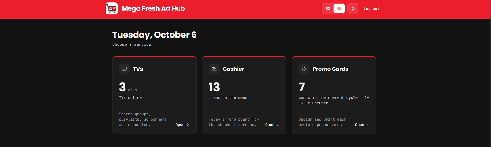
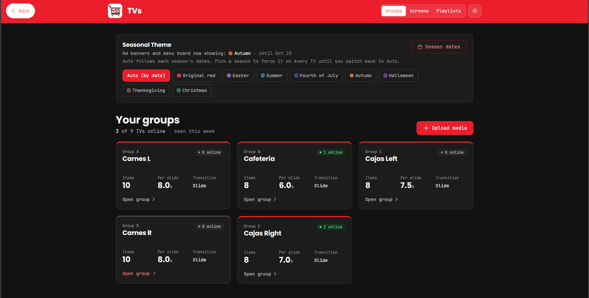
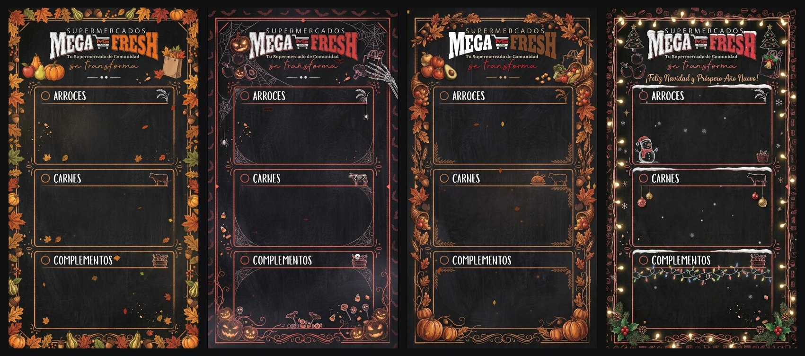
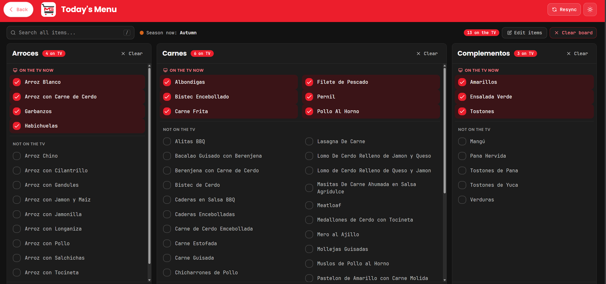
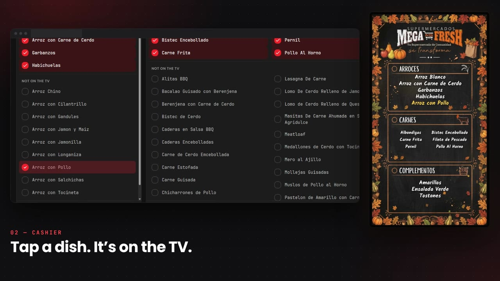
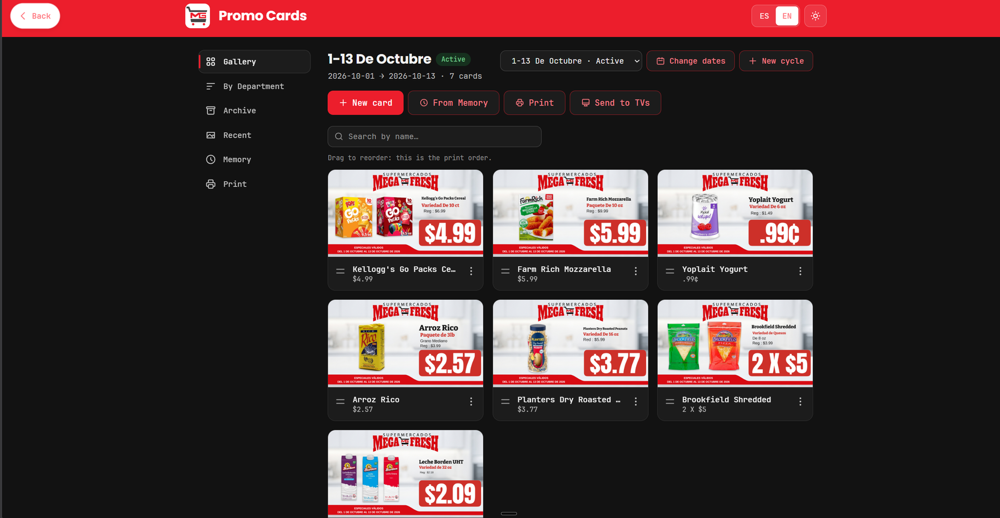
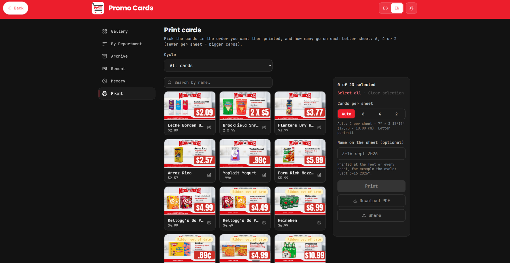
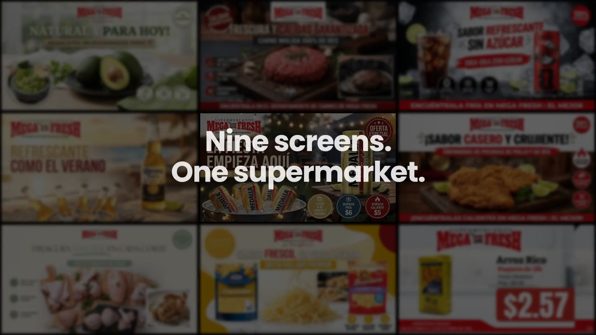

  

<h1 align="center">Mega Fresh Ad Hub</h1>

  <b>TV ads · live menu boards · promo cards</b> 
  One web app that runs every screen in a supermarket.

  

  <a href="https://ohitsgian21.github.io/megafresh-ad-hub/"><b>Open the showcase page</b></a>
  &nbsp;·&nbsp;
  <a href="assets/promo.mp4">Watch the 30-second video in full quality</a>

---

Mega Fresh Ad Hub is the digital signage system I designed and built for **Supermercados Mega Fresh** and **El Mejor Supermarket**. It is in production today: staff sign in once and get three tools that keep nine in-store TVs, the hot-food menu boards and the printed shelf cards in step with each other.

> **This repository is a showcase.** It holds screenshots, a video and a landing page. The application's source code is private.

## One login, three tools

| | Tool | What it does |
|---|---|---|
| 01 | **TVs** | Groups screens by department, plays scheduled playlists and ad banners, and switches seasonal themes by date. |
| 02 | **Cashier** | A touch panel for counter staff: tap a dish and it is on the menu board. |
| 03 | **Promo Cards** | Builds the price cards for each two-week sale, prints them and sends them to the TVs. |

## 01 · TVs

- **Screen groups.** TVs are organised into named groups such as Carnes, Cafetería and Cajas. Each group has its own content, slide timing and transition.
- **Scheduled playlists.** Images, GIFs and video play on rules by time of day, day of week, date range or month, with a fallback so a screen is never blank.
- **Ad banners that expire themselves.** A slide can be pinned or given a start and end date. When a sale ends, its slide leaves the TVs without anyone remembering to remove it.
- **Seasonal themes.** Eight looks, from Easter to Christmas, follow the calendar automatically or can be forced on every TV with one click.
- **Random mode.** TVs that share a group show different items at the same moment, so two screens side by side do not mirror each other.
- **Pairing by code.** A new TV shows a 6-digit code; type it into the app, pick a group, and the TV starts playing.

## 02 · Cashier

- **Tap to publish.** Every dish is one tap on or off, and the menu board on the TV updates straight away.
- **Built for the counter.** Three categories side by side, one search box across all of them, and tabs on a phone or portrait tablet.
- **Clear with undo.** One button empties a category or the whole board for the next day.
- **Menu hours.** A group can show the menu board during lunch service and return to its ads afterwards on its own.

## 03 · Promo Cards

- **Sale cycles.** Cards are organised by the store's two-week promotions, with an archive of past cycles.
- **Real-world prices.** The price line handles deals such as `2 X $5` and `.99¢`, alongside the regular price.
- **Print for the shelf.** Choose 6, 4 or 2 cards per Letter sheet, then print, download a PDF or share.
- **Send to TVs.** The same card goes onto the screens without being rebuilt.

## On the screens

The ads, menu boards and promo cards in this showcase are the real content running in the stores.

---

  Designed and built by <b>Gianlexis Quiñones</b> 
  © 2026 Gianlexis Quiñones. All rights reserved. Store names, logos and product imagery belong to their owners and are shown with permission.

